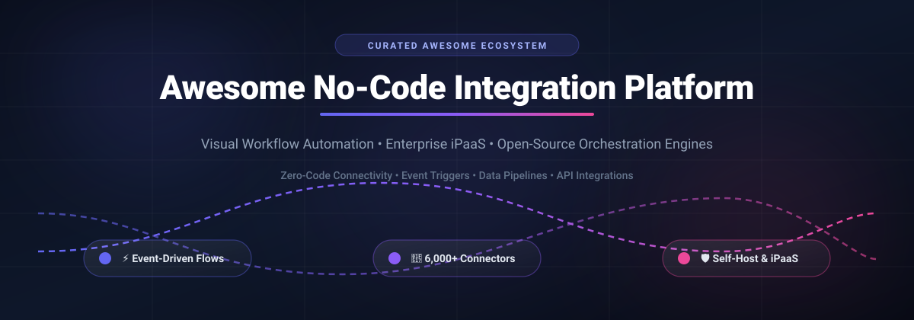

# ⚡ Awesome No-Code Integration Platform 🚀

  <b>A curated list of leading SaaS platforms and open-source GitHub projects for no-code integration, visual workflow automation, enterprise iPaaS, and event-driven orchestration.</b>

Last updated: October 2026 • Maintained with ❤️ by <a href="https://github.com/ishandutta2007">@ishandutta2007</a>

---

## 📌 Table of Contents

- [🌐 Sector Overview & Market Dynamics](#-sector-overview--market-dynamics)
- [☁️ SaaS & Hosted iPaaS Platforms](#️-saas--hosted-ipaas-platforms)
- [🔓 Open-Source GitHub Projects](#-open-source-github-projects)
- [🛠️ Architecture & Custom Stacks](#️-architecture--custom-stacks)
- [🤝 How to Contribute](#-how-to-contribute)
- [💖 Support & Community](#-support--community)
- [📈 Star History](#-star-history)
- [📜 Disclaimer](#-disclaimer)

---

## 🌐 Sector Overview & Market Dynamics

The global **Integration Platform as a Service (iPaaS) and No-Code Workflow Automation** market is estimated at **$12.5B in 2024** and is projected to surpass **$45.0B by 2030**, expanding at an aggressive CAGR of **~24% to 28%**. 

The sector is **moderately fragmented**: mega-cap cloud titans (Microsoft, Salesforce MuleSoft) dominate enterprise-wide governance, data compliance, and deep infrastructure contracts, while agile best-of-breed SaaS players (Zapier, Make, Workato, Tray.io) capture high-growth business-unit workflows and product automations. Concurrently, a vibrant wave of open-source and fair-code platforms (n8n, Activepieces, Windmill, Kestra) is capturing significant market share driven by data sovereignty, self-hosting privacy requirements, and customizable AI/API pipeline architectures.

---

## ☁️ SaaS & Hosted iPaaS Platforms

The table below compiles premier SaaS and managed cloud integration suites, ordered by estimated company valuation / annual revenue scale (descending):

| Platform | Company Valuation / Revenue | Starting Pricing Tier | Free Tier Limit / Trial Duration | Primary Focus & Highlights |
| :--- | :--- | :--- | :--- | :--- |
| **[Microsoft Power Automate](https://powerautomate.microsoft.com/)** | **~$3.1T Valuation** (~$140B Cloud Rev) | **$15 / user / month** (Power Automate Premium) | **90-Day Free Trial** with full premium connector access; free Power Automate for desktop included with Windows 11 | Enterprise robotic process automation (RPA), deep Microsoft 365 / Azure integration, and AI Builder capabilities. |
| **[Salesforce MuleSoft Composer](https://www.mulesoft.com/platform/composer)** | **~$280B Valuation** ($38B Rev) | **$21,000 / organization / year** (Composer Starter package) | **30-Day Free Trial** via Salesforce sandbox environment with sample integration flows | Native Salesforce CRM workflow builder connecting external business tools with managed enterprise connectors. |
| **[Workato Recipe Builder](https://www.workato.com/)** | **~$5.7B Valuation** (~$300M ARR) | **$10,000 / year** (Base workspace + ~$2,000 / pack of recipes) | **14-Day Free Trial** with guided workspace setup and live recipe sandboxing | Enterprise-grade iPaaS with low-code/no-code recipes, API proxying, bot triggers, and stringent governance controls. |
| **[Zapier](https://zapier.com/)** | **~$5.0B Valuation** (~$250M ARR) | **$19.99 / month** (billed annually at $239.88/yr for Starter plan) | **Free Forever Plan** (100 tasks/month, 5 active single-step Zaps, 15-min update checks) + 14-day trial of Professional tier | Industry gold standard with 6,000+ pre-built integrations, multi-app Zaps, conditional paths, and AI assistants. |
| **[Tray.io](https://tray.io/)** | **~$1.2B Valuation** (~$80M ARR) | **$595 / month** (billed annually for Pro tier) | **14-Day Free Trial** with sandbox workspace access and universal connector library | Scalable low-code orchestration platform supporting complex logic branching, webhook streams, and enterprise data flows. |
| **[Make](https://www.make.com/)** | **~$1.0B Valuation** (Celonis ~$13B parent) | **$9.00 / month** (billed annually at $108/yr for Core plan) | **Free Forever Plan** (1,000 operations/month, 2 active scenarios, 15-min scheduling, 100 MB data transfer) | Highly visual scenario canvas supporting routers, granular iterations, error handlers, and 2,000+ apps. |
| **[Pipedream](https://pipedream.com/)** | **~$350M Valuation** (~$15M ARR) | **$19 / month** (billed annually for Basic plan) | **Free Forever Plan** (333 daily compute credits, 3 active workflows, 2,000+ connected accounts) | Developer-friendly visual canvas combining low-code blocks with custom Node.js, Python, and Go step functions. |
| **[IFTTT Enterprise](https://ifttt.com/enterprise)** | **~$250M Valuation** (~$30M ARR) | **$3.49 / month** (IFTTT Pro tier; Enterprise custom starting ~$199/mo) | **Free Forever Plan** (2 active applets, standard speed execution, unlimited applet runs) | Streamlined event-driven automation platform connecting consumer devices, IoT sensors, and corporate web services. |
| **[Unito](https://unito.io/)** | **~$80M Valuation** (~$12M ARR) | **$99 / month** (billed annually for Starter plan, 250 items synced) | **14-Day Free Trial** (unlimited sync items, full connector library, no credit card required) | Deep bidirectional two-way data synchronization engine tailored for project management systems and CRMs. |
| **[Integrately](https://integrately.com/)** | **~$20M Valuation** (~$5M ARR) | **$19.99 / month** (billed annually for Starter plan, 2,000 tasks) | **Free Forever Plan** (100 tasks/month, 5 active 1-step automations, 15-min check interval) + 14-day trial | Cost-effective 1-click automation platform with millions of pre-built recipes and intuitive multi-step chains. |

---

## 🔓 Open-Source GitHub Projects

Explore the top self-hostable and transparent workflow engines, integration frameworks, and visual automation repositories. All projects are sorted in **descending order by GitHub stargazers**:

| Repository & Stars_Badge | Description & Capabilities | License |
| :--- | :--- | :--- |
| **[n8n](https://github.com/n8n-io/n8n)**    | Premier fair-code workflow automation tool with 400+ native nodes, visual canvas, AI agents, and custom JS/Python execution. | Sustainable Use License |
| **[Supabase](https://github.com/supabase/supabase)**    | Open-source Firebase alternative featuring built-in database webhooks, Edge Functions, real-time triggers, and event pipelines. | Apache-2.0 |
| **[NocoDB](https://github.com/nocodb/nocodb)**    | Open-source smart spreadsheet-database turning relational databases into no-code tables with webhook integrations and triggers. | AGPL-3.0 |
| **[Huginn](https://github.com/huginn/huginn)**    | Open-source agent ecosystem to monitor online data, scrape websites, parse webhooks, and trigger custom event workflows. | MIT |
| **[Apache Airflow](https://github.com/apache/airflow)**    | Industry standard programmatic workflow orchestration engine with Python DAGs, rich connector operators, and task scheduling. | Apache-2.0 |
| **[ToolJet](https://github.com/ToolJet/ToolJet)**    | Open-source low-code platform with visual app builder, background workflow engine, and 50+ data source connectors. | AGPL-3.0 |
| **[Appsmith](https://github.com/appsmithorg/appsmith)**    | Powerful open-source low-code internal tool software equipped with reactive workflows, REST/GraphQL triggers, and JS blocks. | Apache-2.0 |
| **[Directus](https://github.com/directus/directus)**    | Open-source Data Studio and headless API engine with visual flows, event listeners, webhook dispatchers, and conditional operations. | BSL-1.1 / GPL-3.0 |
| **[Kestra](https://github.com/kestra-io/kestra)**    | Declarative orchestration and scheduling platform with visual YAML flow designer, event-driven triggers, and 500+ plugins. | Apache-2.0 |
| **[Budibase](https://github.com/Budibase/budibase)**    | Low-code developer platform with a built-in visual automation engine, multi-step actions, and third-party connector hooks. | GPL-3.0 |
| **[Activepieces](https://github.com/activepieces/activepieces)**    | No-code business automation suite and Zapier alternative with 200+ community pieces, visual builder, and AI step actions. | MIT |
| **[Prefect](https://github.com/PrefectHQ/prefect)**    | Modern workflow coordination orchestration platform with Python-native flows, instant UI observability, and automated retries. | Apache-2.0 |
| **[Node-RED](https://github.com/node-red/node-red)**    | Flow-based visual programming environment for wiring hardware devices, APIs, and online services together seamlessly. | Apache-2.0 |
| **[Temporal](https://github.com/temporalio/temporal)**    | Durable execution platform for orchestrating mission-critical multi-step microservices and fault-tolerant business workflows. | MIT |
| **[Windmill](https://github.com/windmill-labs/windmill)**    | High-performance developer platform turning Python, TypeScript, Go, and SQL scripts into visual flows and internal apps. | AGPL-3.0 |
| **[Trigger.dev](https://github.com/triggerdotdev/trigger.dev)**    | Developer-first platform for background jobs, long-running workflows, and event-driven API orchestration without timeouts. | Apache-2.0 |
| **[Logstash](https://github.com/elastic/logstash)**    | Server-side data processing pipeline that ingests data from multiple sources simultaneously, transforms it, and sends it to stashes. | Apache-2.0 |
| **[Automatisch](https://github.com/automatisch/automatisch)**    | Self-hosted business workflow automation tool and privacy-centric Zapier alternative with zero vendor lock-in. | AGPL-3.0 |
| **[Flowable](https://github.com/flowable/flowable-engine)**    | Leading BPMN, CMMN, and DMN business process and rule automation engine for enterprise workflow orchestration. | Apache-2.0 |
| **[StackStorm](https://github.com/StackStorm/st2)**    | Event-driven DevOps automation and auto-remediation platform connecting sensors, rules engines, and workflow actions. | Apache-2.0 |
| **[Beehive](https://github.com/muesli/beehive)**    | Flexible, modular event and automation framework with community hives for notifications, social bots, and custom actions. | MIT |
| **[Apache Camel](https://github.com/apache/camel)**    | Versatile open-source integration framework implementing Enterprise Integration Patterns with 300+ protocol components. | Apache-2.0 |
| **[Rundeck](https://github.com/rundeck/rundeck)**    | Runbook automation service providing self-service operations, script execution workflows, and access management. | Apache-2.0 |
| **[Apache NiFi](https://github.com/apache/nifi)**    | Visual data flow orchestration tool with real-time routing, transformation, and comprehensive data provenance tracing. | Apache-2.0 |
| **[Baserow](https://github.com/bram2w/baserow)**    | Open-source no-code database platform featuring native webhook integrations, formula engines, and automation events. | MIT |
| **[Inngest](https://github.com/inngest/inngest)**    | Event-driven durable execution engine for step functions, background queues, delay operations, and stateful flows. | Apache-2.0 |
| **[Cronicle](https://github.com/jhuckaby/Cronicle)**    | Multi-server distributed task scheduler and automation utility with real-time web UI and live log output viewer. | MIT |
| **[Camunda 7](https://github.com/camunda/camunda-bpm-platform)**    | Flexible enterprise framework for BPMN process automation and DMN decision execution with visual diagrams. | Apache-2.0 |
| **[Kubeflow Pipelines](https://github.com/kubeflow/pipelines)**    | Kubernetes-native platform for deploying, scheduling, and tracking end-to-end machine learning workflows and pipelines. | Apache-2.0 |
| **[Corteza](https://github.com/cortezaproject/corteza)**    | 100% open-source low-code enterprise platform with visual CorWorkflow engine, records automation, and CRM models. | Apache-2.0 |
| **[Joget DX](https://github.com/jogetworkflow/jw-community)**    | Next-generation open-source low-code/no-code application development and business process automation platform. | Apache-2.0 |
| **[Redpanda Benthos](https://github.com/redpanda-data/benthos)**    | Ultra-lightweight stream processor and data pipeline connector engine with declarative YAML mappings. | MIT |
| **[ProcessMaker](https://github.com/processmaker/processmaker)**    | Open-source BPM workflow engine with drag-and-drop form and flow designers for automating corporate procedures. | AGPL-3.0 |
| **[Bonita Engine](https://github.com/bonitasoft/bonita-engine)**    | Extensible business process management (BPM) engine providing process orchestration and connector integrations. | GPL-2.0 |

---

## 🛠️ Architecture & Custom Stacks

When architecting a sovereign, cost-effective self-hosted automation infrastructure, consider combining these complementary layers:
- **Visual Workflow & No-Code Tier**: Deploy **n8n** or **Activepieces** for team-facing drag-and-drop workflow construction and instant SaaS connector management.
- **Microservices & Resilient Execution**: Utilize **Temporal** or **Inngest** for resilient, durable transaction execution where state cannot be lost.
- **Event Streaming & Ingestion**: Pair with **Kafka**, **RabbitMQ**, or **Redpanda** for decoupling incoming high-velocity webhook payloads.
- **Data & Process Storage**: Combine **PostgreSQL** with **NocoDB** or **Baserow** for flexible tabular visibility into automated business records.

---

## 🤝 How to Contribute

Contributions are warmly encouraged! Help keep this directory accurate and comprehensive:
1. 🍴 **Fork the repository** on GitHub.
2. 🌿 **Create a feature branch** (`git checkout -b feature/add-new-platform`).
3. 📝 **Add or update records** in `README.md` following existing tabular formatting and factual specs.
4. 🚀 **Submit a Pull Request** with a concise description of the tool and pricing/license model.

---

## 💖 Support & Community

If this curated collection helped you navigate the no-code integration and automation landscape, please consider supporting the project:

- ⭐ **Star this repository** to help others discover it!
- 🍴 **Fork and share** with teammates, automation engineers, and developers.
- 💬 **Join our community on Discord**: [Join Discord Server](https://discord.gg/jc4xtF58Ve)
- ☕ **Sponsor & Buy a Coffee**: Your sponsorship powers continuous maintenance and curation! Support via the [GitHub Sponsors Dashboard](https://github.com/sponsors/ishandutta2007).

  

---

## 📈 Star History

---

## 📜 Disclaimer

- This repository is a **community-curated directory** created for informational, educational, and evaluation purposes.
- All product names, logos, and brands are property of their respective owners.
- Integration platforms handling sensitive personal or transactional data must comply with relevant data security and privacy regulations (such as GDPR, CCPA, SOC 2, and HIPAA).
